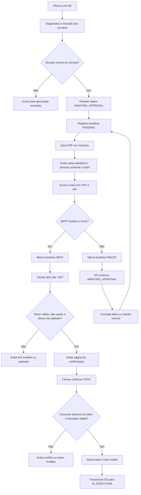

# Fluxo de envio e aprovação da Ordem de Serviço

O GET do link não altera a OS; somente o POST explícito confirma a aprovação. As operações de consulta/reenvio da entrega são autenticadas; as rotas públicas se limitam à confirmação por token.
